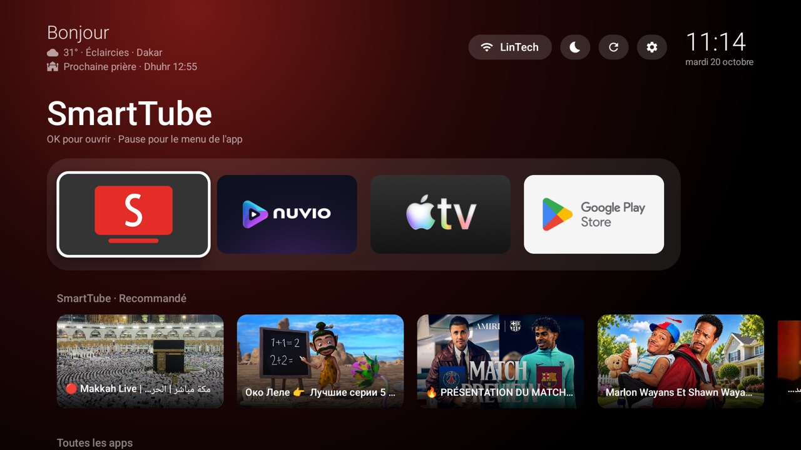
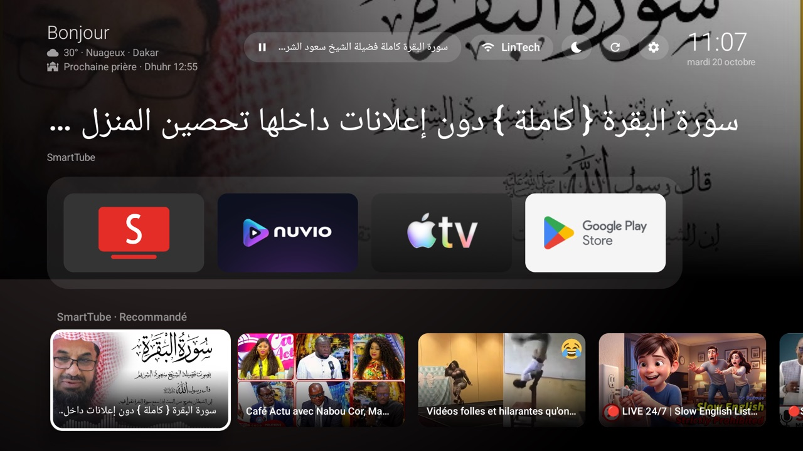
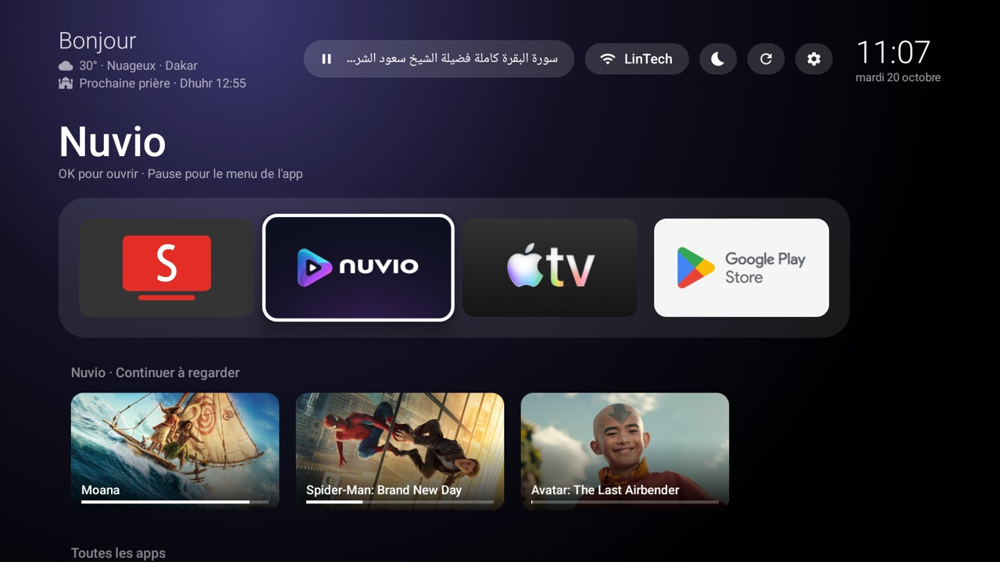
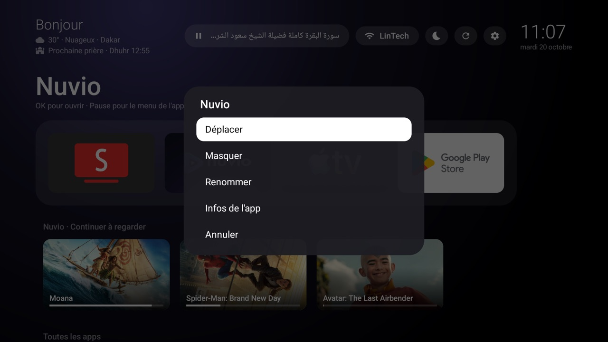
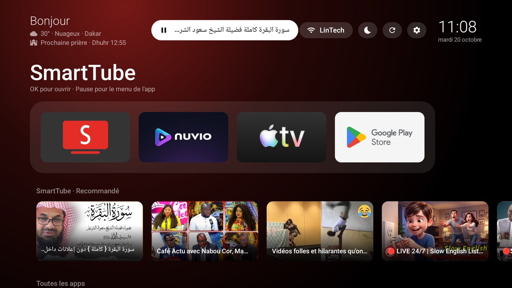
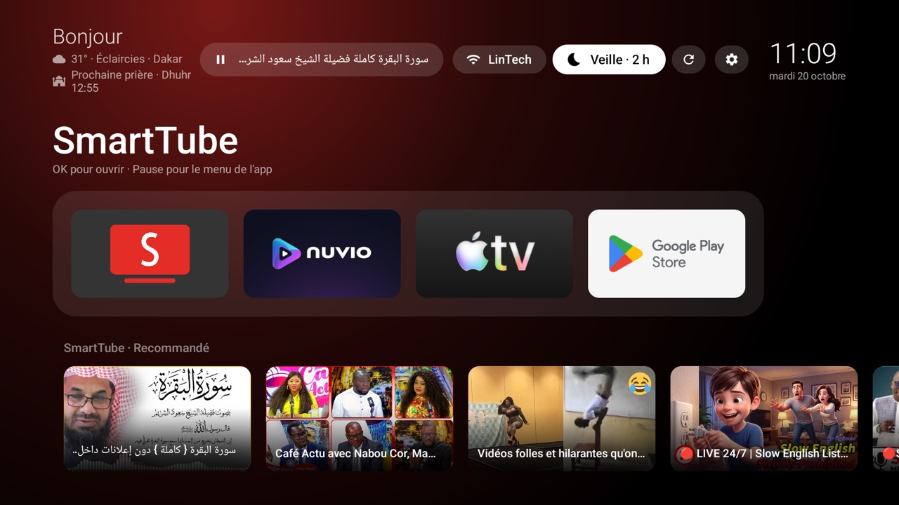
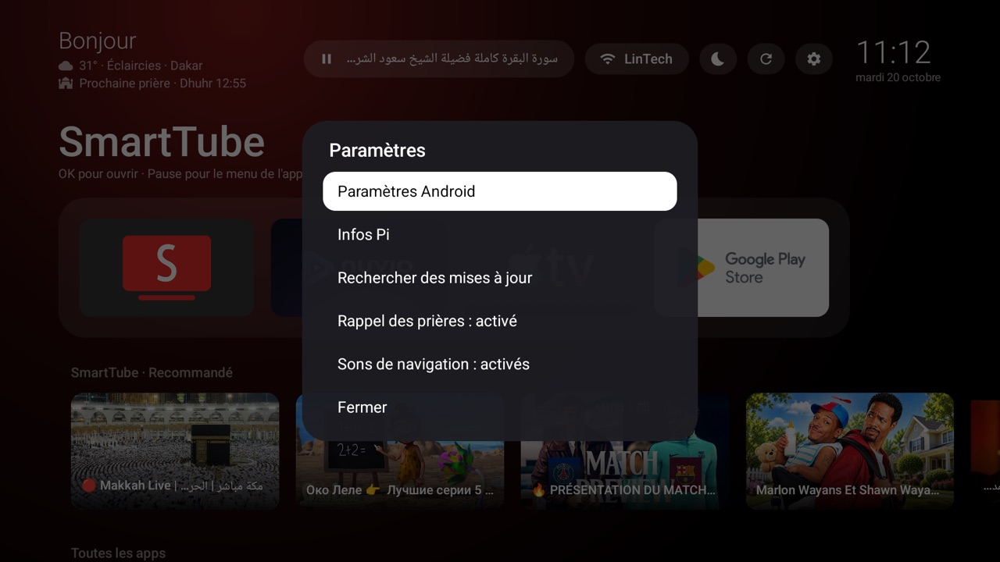
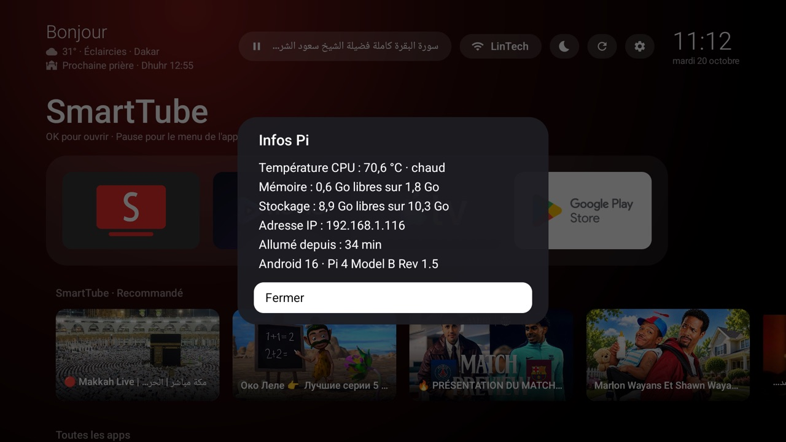
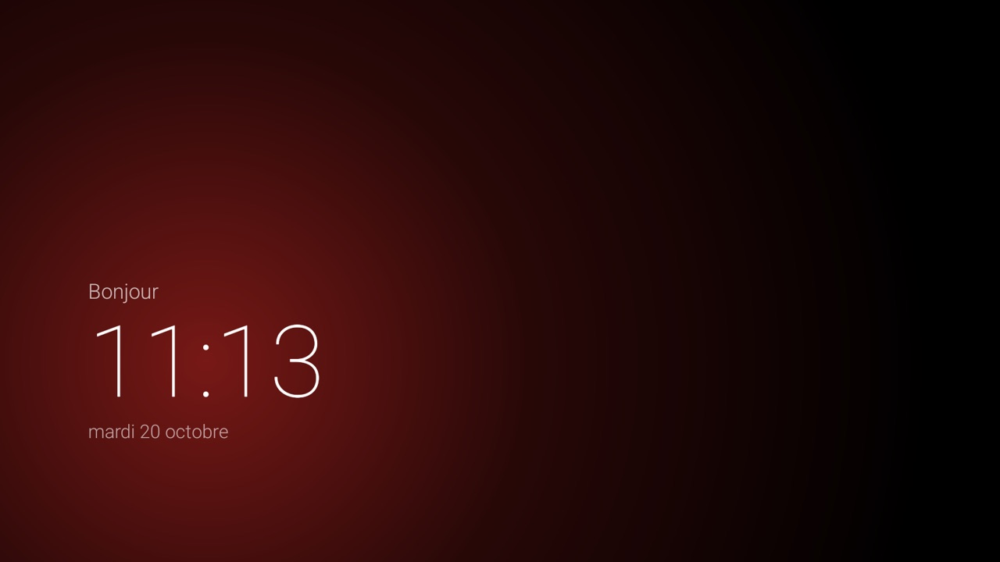

# Pi Home

An Apple TV-style home screen for a Raspberry Pi 4 running Android TV, controlled with the TV's
own LG remote.



- **Launcher**: a single 60 KB app, plain Java with no libraries. Dock, a row that follows the
  highlighted app, weather, prayer times, a sleep timer, a screensaver and app updates.
- **LG remote bridge**: an old LG TV only passes its remote to devices it recognises as LG. The
  bridge makes the Pi answer as one, so the TV remote drives Android.
- **AirPlay receiver**: mirror a Mac or iPhone onto the TV, or use the TV as a second Mac screen.
  No ads, no premium screen.

Built for a Pi 4 (2 GB) with [KonstaKANG's LineageOS Android TV](https://konstakang.com/devices/rpi4/),
connected to HDMI 3 of an LG TV. How it works inside, the Pi tweaks and troubleshooting are in
[docs/HOW-IT-WORKS.md](docs/HOW-IT-WORKS.md).

---

## Screenshots

<table>
  <tr>
    <td width="50%"><br><sub>Highlighted video: its artwork fills the top</sub></td>
    <td width="50%"><br><sub>The row follows the app: Nuvio's films in progress</sub></td>
  </tr>
  <tr>
    <td width="50%"><br><sub>App menu (Pause): move, hide, rename, info</sub></td>
    <td width="50%"><br><sub>Now playing, for audio in the background</sub></td>
  </tr>
  <tr>
    <td width="50%"><br><sub>Sleep timer running: « Veille · 2 h »</sub></td>
    <td width="50%"><br><sub>⚙ Paramètres menu</sub></td>
  </tr>
  <tr>
    <td width="50%"><br><sub>Infos Pi: temperature, memory, storage</sub></td>
    <td width="50%"><br><sub>Clock screensaver</sub></td>
  </tr>
</table>

---

## The home screen

| | |
|---|---|
| | |
|---|---|
| **Background** | A landscape from Wikimedia Commons' featured pictures of lakes and mountains (or Bing's photo of the day), a new one every 6 hours, kept for offline starts; its author and licence at the bottom left |
| **Middle** | Greeting, date and weather over a large glass clock, then the next prayer |
| **Top right** | Now playing (when something plays in the background), ⬆ updates, 🌙 the sleep timer's time left, "Hors ligne" when offline, then 🔍 search and the control panel |
| **Dock** | Your apps as rounded square icons (4 at first, up to 8), the highlighted one's name in a bubble over it, and ▦ Toutes les apps at the end |

From 23:00 to 06:00 the screen dims.

The clock's digits are glass too: filled with a blurred, brightened copy of the photo, under a
frost that whitens toward their foot and a bright outline, in Antonio Light.

**Photo** in the control panel shows the next photo now, or switches between the Commons
landscapes and Bing's photo of the day. The Commons pictures are freely licensed (mostly
CC BY-SA); the credit line names the photographer and the licence, as they require.

The dock, the buttons, the cards and the windows are frosted glass: each shows a blurred copy of
what is behind it (the photo; the whole screen, for a window), more vivid than the original, under
a tint that darkens over bright parts and frosts over dark ones, with a magnified band along the
edge as thick glass bends light, a sheen, and a rim lit at two corners. The blur is made once each time the background changes,
on a picture a tenth of the screen's size, so it costs nothing while moving around.

### Content above the app

When the highlighted app has something to show, "▲ SmartTube · Recommandé" (or the like) appears
over the dock. **Up** brings it in, under the clock, as a row of glass cards (picture, app, title,
time left and progress): SmartTube's recommendations, Nuvio's and
Pi TV's films and episodes in progress, Pi TV's recent channels. Apps that publish nothing show
everyone's "Continuer à regarder" instead, leaving out the apps you've hidden.

OK opens a card directly in the app. **Down** or **Back** returns to the dock.

### Reprendre, for every app

Pi Home follows what every app plays through its media session (the same way it shows "now
playing") and keeps the title, the picture and where it stopped, for anything longer than five
minutes. Those come first in the app's row ("Apple TV · Reprendre"), and in the row of apps that
publish nothing. OK goes back to the player's own screen when Android still has it, else it opens
the app. A programme watched to the end is dropped; the rest after 30 days.

### Recent apps

**Home twice** (or Récentes in the control panel): the apps used this week, latest first. OK opens
one; **Up** closes it (the root bridge force-stops it, so even audio playing in the background
stops); "Tout fermer" closes them all. Needs usage access, granted once with
`adb shell appops set com.sall.pihome GET_USAGE_STATS allow`.

### Search

🔍 at the top right: a keyboard over the blurred screen. As letters are typed, matching apps and
Pi Home's own actions (Wi-Fi, Bluetooth, Infos Pi, sleep, restart, photo…) list on the right,
accents ignored. From two letters, the words can be sent to Pi TV (its Search page opens with
them) or to SmartTube.

### Now playing

When an app keeps playing in the background, for example SmartTube's audio-only mode, a button
with the title appears in the top bar. OK on it pauses or resumes.

---

## Organising your apps

Press **Pause** on an app to open its menu.

- **Déplacer**: the app gets a blue frame; move it with the arrows, OK to drop it. A dock app
  moves within the dock, an app of Toutes les apps within that window.
- **Ajouter au dock** / **Retirer du dock**: up to 8 apps in the dock.
- **Masquer**: hides it from the home screen.
- **Renommer**: gives it another name. "Nom d'origine" restores the original.
- **Infos de l'app**: Android's page for the app (storage, permissions, force stop).

Hidden apps go into a **Masquées** tile at the end of Toutes les apps, behind a 4-digit code: the
first time, OK on the tile asks you to choose one. After the code, each hidden app can be opened
or shown again, and the code changed. Type it with the on-screen keypad or the remote's number
keys; it stays unlocked until you leave the home screen. Forgot it? With root:
`adb shell "sed -i '/name=\"code\"/d' /data/data/com.sall.pihome/shared_prefs/home.xml"`, then
restart Pi Home (`adb shell am force-stop com.sall.pihome`).

New apps appear at the end of Toutes les apps by themselves.

---

## Sleep, timer, restart

**Minuterie de veille** (in the control panel) puts the Pi to sleep now, or in 30 min, 1 h or
2 h. While a timer runs, a 🌙 button in the top bar shows the time left, and its menu adds
"Annuler la minuterie". **Veille** at the bottom of the panel puts it to sleep at once. Any button on the remote wakes
the Pi.

After midnight, if nothing has been touched for an hour, the Pi goes to sleep by itself.

---

## The control panel

Up from the dock, then OK on the button at the top right: a glass panel slides in.

- **Réseau**: the Wi-Fi network (or "Hors ligne"); OK opens Android's network settings.
- **Bluetooth**: on or off; OK opens Android's Bluetooth settings (pairing a headset).
- **Mémoire**: RAM and CPU use, live; OK opens Infos Pi.
- **Paramètres**: the usual Android TV settings.
- **Photo**: the next home photo, or where they come from.
- **Infos Pi**: processor temperature, free memory and storage, IP address, time since the last
  restart, and the data used today and this month with the 3 apps that used the most. Refreshes
  every 2 seconds; Android only saves data figures about every 30 minutes. Up to about 75 °C is normal; the Pi slows itself down from
  80 °C.
- **Mises à jour**: what is available, or checks SmartTube and Nuvio now (see below).
- **Réparer le Bluetooth**: when Bluetooth stops working. The Pi's Bluetooth chip sometimes
  reports a hardware error; Android then crashes a few times in a row and gives up, leaving
  Bluetooth off. This resets the chip itself (its driver is unbound and bound again, which powers
  it off and on and reloads its firmware), then starts Android's Bluetooth again. Takes about 15
  seconds; paired devices reconnect by themselves.
- **Redémarrer**: restarts the Pi, after a confirmation.

---

## Prayer times

The next prayer shows under the weather, at the top left of the home screen. At prayer time, a
banner "C'est l'heure de la prière · Dhuhr 12:55" appears for 30 seconds, even over SmartTube or
Nuvio.

Times come from [Aladhan](https://aladhan.com) with the Muslim World League method, for the
location of your internet connection (Dakar). Mosques sometimes differ by a few minutes,
especially for Fajr and Isha.

---

## Screensaver

After 15 minutes without input, a thin clock appears over the last glow colour. It moves every
minute so nothing burns into the TV. Any button brings back the home screen.

---

## AirPlay

On the Mac or iPhone, open **Screen Mirroring** and choose **Pi**. The TV switches to the mirrored
screen by itself, with the sound. On the Mac, "Use as separate display" extends the desktop onto
the TV. **Back** on the remote leaves the mirrored screen; stop mirroring on the Mac or iPhone.

The **AirPlay** tile shows « AirPlay prêt » with these instructions. The receiver starts with the
Pi and uses no CPU while nothing is mirrored.

The Wi-Fi sets the speed: the picture goes Mac → router → Pi. An Ethernet cable for the Pi, the
router at 40 MHz channel width, or 1280 × 720 for the TV in the Mac's display settings all make it
smoother. How it works: [airplay/README.md](airplay/README.md).

---

## Pi TV (IPTV)

**Pi TV** plays an IPTV subscription with a Netflix-style interface: Accueil, TV en direct, Films,
Séries, Ma liste, Recherche. It takes an **Xtream Codes** login (server, user, password) or an
**M3U playlist** link, with an optional XMLTV programme guide.

The first time, Pi TV opens on Paramètres. The easiest way to fill it in is from a phone on the
same Wi-Fi: open the address shown on the TV (`http://192.168.1.116:8765`) and fill in the form.

- **OK** opens a film or series, or plays a channel. **Pause** on a poster or channel adds it to
  Ma liste (favourite channels).
- In a channel, **up / down** switch channels in the same category; **OK** opens the channel list.
- In a film, **left / right** move back and forward; **OK** shows Pause, Audio, Sous-titres,
  Épisode suivant and Format. The chosen audio and subtitle languages are kept for the next film.
- Films and episodes resume where you stopped (Continuer à regarder on Accueil).

Geo-blocked German and EU channels play through a proxy on the Hetzner server, over Tailscale.

Details and how it stays reliable: [iptv/README.md](iptv/README.md).

---

## App updates

SmartTube and Nuvio don't come from the Play Store, so nothing updates them. Pi Home checks
their GitHub releases 20 seconds after the Pi starts, then every 12 hours. When there's a new
version, a **⬆** button appears in the top bar: choose an app, or "Tout mettre à jour". It
downloads the Pi 4 version and installs it silently. Settings and logins are kept.

Installing an update closes the app, so it stops anything it was playing.

---

## The LG remote

| Button | On the Pi |
|---|---|
| ↑ ↓ ← → | Navigate; hold to scroll |
| **OK** | Select |
| **Play** ▶ | Play in apps; opens the highlighted app on the home screen |
| **Pause** ⏸ | Play/pause in apps; opens the app menu on the home screen |
| **Stop** ■ | Home |
| **Back** | Back |
| Skip ⏭ | Next |
| EXIT, colours, numbers | Nothing: the TV keeps these |

If the remote stops responding, switch the TV input away from HDMI 3 and back.

---

## Recommended SmartTube settings

- **Video quality** (in the player): **480p 30fps avc**. The Pi 4 decodes AVC (H.264) in
  hardware; VP9 and AV1 fall back to the processor, which runs hotter and can stutter. Take 60 fps
  only for sport or games.
- **Paramètres → Lecture en arrière-plan → Uniquement l'audio**: keeps the sound playing after
  Stop ■, and shows the now-playing button.

---

## Build and install

You need the Android SDK (build-tools 36.1.0, platform 36) and Android Studio's bundled JDK, as
installed by Android Studio on macOS. There is no Gradle.

```sh
./build.sh            # builds build/pihome.apk
./build.sh install    # builds and installs over the Pi's copy, keeping your settings
./setup.sh            # full install on a fresh Pi: system files, reboot, settings, AirPlay
airplay/install.sh    # builds and installs only the AirPlay receiver (uses Gradle)
iptv/install.sh       # builds and installs Pi TV, the IPTV player (uses Gradle)
```

`PI_HOST` changes the Pi's address (default `192.168.1.116:5555`).

Updating Pi Home restarts the home screen, which also stops SmartTube's background audio.

Back up **`pihome.keystore`**, **`airplay/piairplay.keystore`** and **`iptv/pitv.keystore`**. They sign the three apps, and
updates must use the same keys. They're deliberately left out of Git.

## Project layout

| Path | What it is |
|---|---|
| `src/com/sall/pihome/` | The launcher. `MainActivity` is the home screen; `WatchNext`, `Weather`, `Prayers`, `Updates`, `PiInfo` fetch its data; `ClockDream` is the screensaver; `GlowView` draws the glow; `Glass` the frosted panels; `Wallpaper` fetches the home photo; `Resume` remembers what apps play; `GlassClock` draws the clock; `Icons` draws each app's square icon; `Bubble` the name bubble |
| `res/` | Icons and the theme |
| `AndroidManifest.xml` | Permissions, the home screen and the screensaver |
| `bridge/lg-simplink.sh` | The LG remote bridge, which also carries out sleep, restart, installs and the Bluetooth reset |
| `bridge/lg-simplink.rc` | Starts the bridge at boot |
| `privapp-permissions-pihome.xml` | Allows the launcher's three system permissions |
| `airplay/` | The AirPlay receiver, a separate app built with Gradle; see its [README](airplay/README.md) |
| `iptv/` | Pi TV, the IPTV player, a separate app built with Gradle; see its [README](iptv/README.md) |
| `build.sh`, `setup.sh` | Build, and install on a fresh Pi |
| `docs/` | This guide's screenshots and [HOW-IT-WORKS.md](docs/HOW-IT-WORKS.md) |

---

## Credits

The glass recipe (saturation, lens band, adaptive tint, diagonal rim), the square-icon builder, the
dark focus frame on light icons, the name bubble, the glass clock and the focus timings are adapted from
[tvOS Launcher](https://github.com/techgenius1/tvOS-Launcher) by techgenius1, Apache License 2.0.

The clock font is [Antonio](https://github.com/googlefonts/antonioFont) (`res/font/antonio.ttf`),
SIL Open Font License 1.1, see `OFL-Antonio.txt`. Home photos come from Wikimedia Commons under
their authors' licences, shown with each photo.
