# Pi Home

An Apple TV-style home screen for a Raspberry Pi 4 running Android TV, controlled with the TV's
own LG remote.

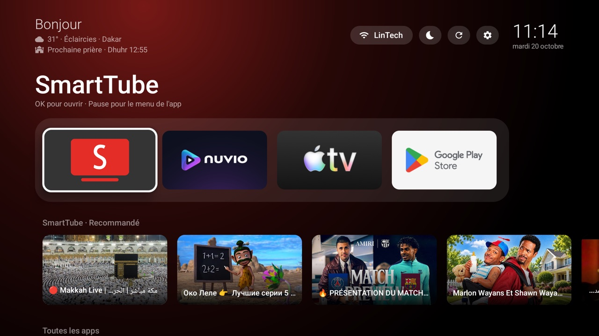

- **Launcher**: a single 60 KB app, plain Java with no libraries. Dock, a row that follows the
  highlighted app, weather, prayer times, a sleep timer, a screensaver and app updates.
- **LG remote bridge**: an old LG TV only passes its remote to devices it recognises as LG. The
  bridge makes the Pi answer as one, so the TV remote drives Android.

Built for a Pi 4 (2 GB) with [KonstaKANG's LineageOS Android TV](https://konstakang.com/devices/rpi4/),
connected to HDMI 3 of an LG TV. How it works inside, the Pi tweaks and troubleshooting are in
[docs/HOW-IT-WORKS.md](docs/HOW-IT-WORKS.md).

---

## The home screen

| | |
|---|---|
| **Top left** | Greeting (Bonjour, Bon après-midi, Bonsoir), weather, next prayer |
| **Top right** | Now playing (when something plays in the background), Wi-Fi, 🌙 Veille, ⟳ Redémarrer, ⚙ Paramètres, clock |
| **Title** | Name of the highlighted app, or of the highlighted video |
| **Dock** | Your first 4 apps |
| **Row** | Content from the highlighted app |
| **Toutes les apps** | Every other app, plus the hidden ones |

The background glows in the colour of the highlighted app. From 23:00 to 06:00 the screen dims.

### A row that follows the app

The row under the dock shows what the highlighted app publishes: SmartTube's recommendations,
Nuvio's films and episodes in progress. Apps that publish nothing show everyone's
"Continuer à regarder" instead.

| SmartTube highlighted | Nuvio highlighted |
|---|---|
|  | 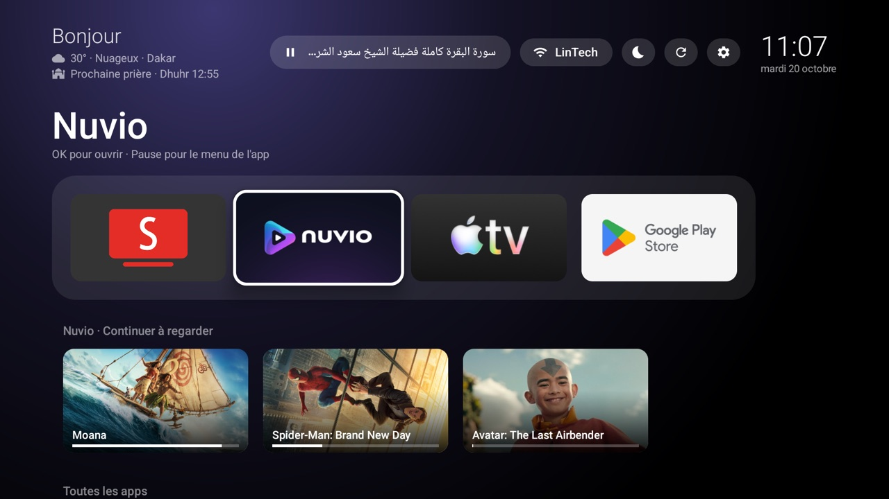 |

Move down onto a card and its artwork fills the top of the screen. OK opens it directly in the app.

| A SmartTube video | A Nuvio film, with the time left |
|---|---|
| 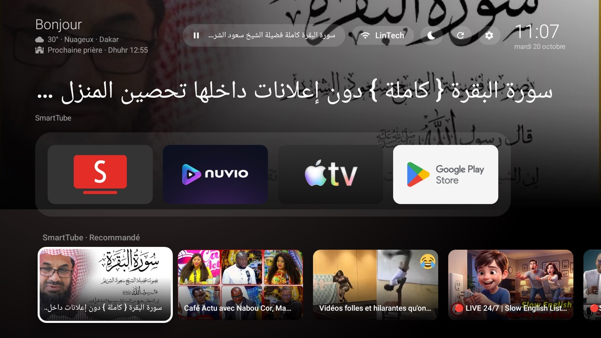 | 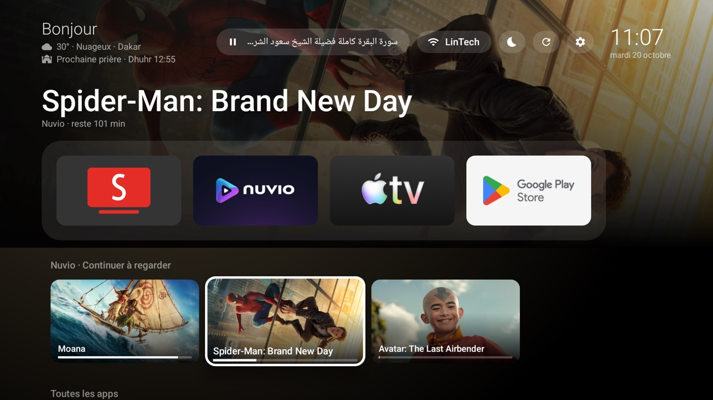 |

### Now playing

When an app keeps playing in the background, for example SmartTube's audio-only mode, a button
with the title appears in the top bar. OK on it pauses or resumes.

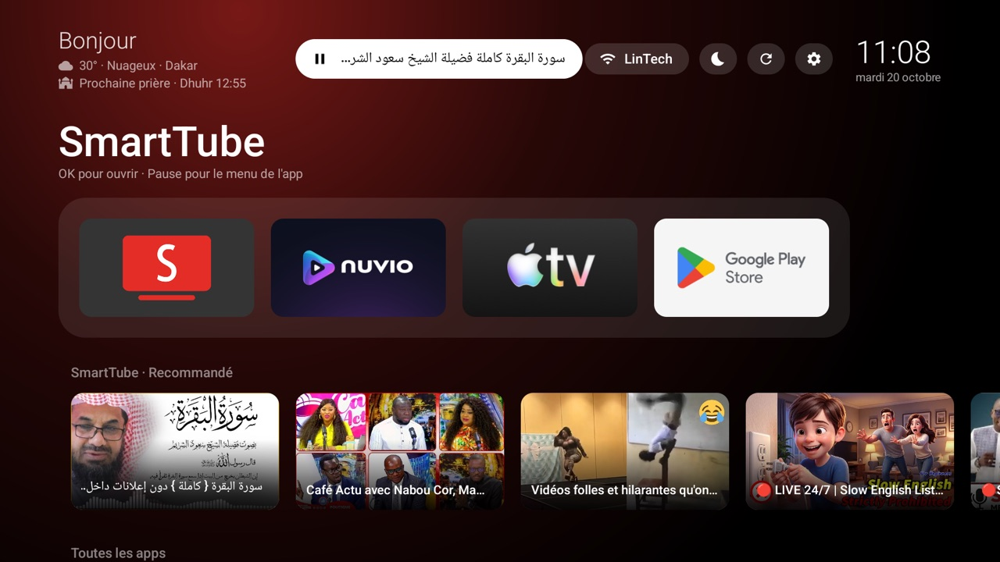

---

## Organising your apps

Press **Pause** on an app to open its menu.

| App menu | Moving an app (blue frame) |
|---|---|
| 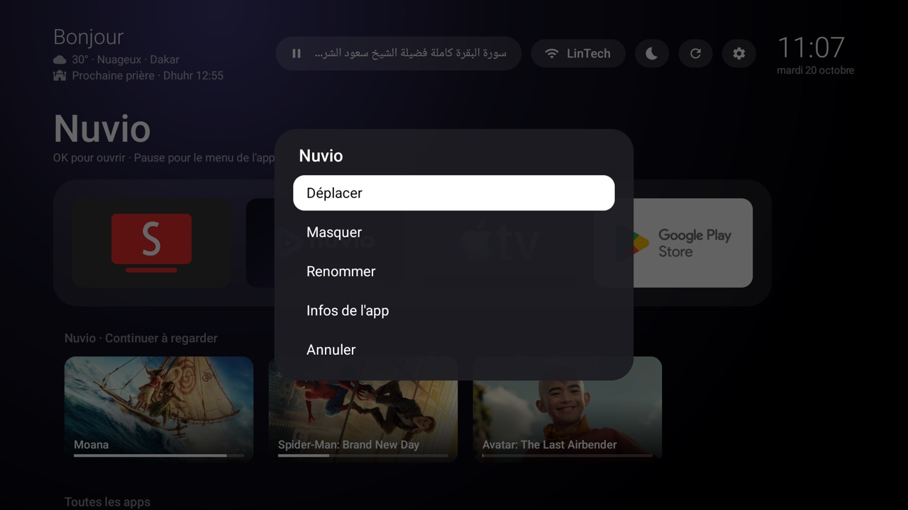 | 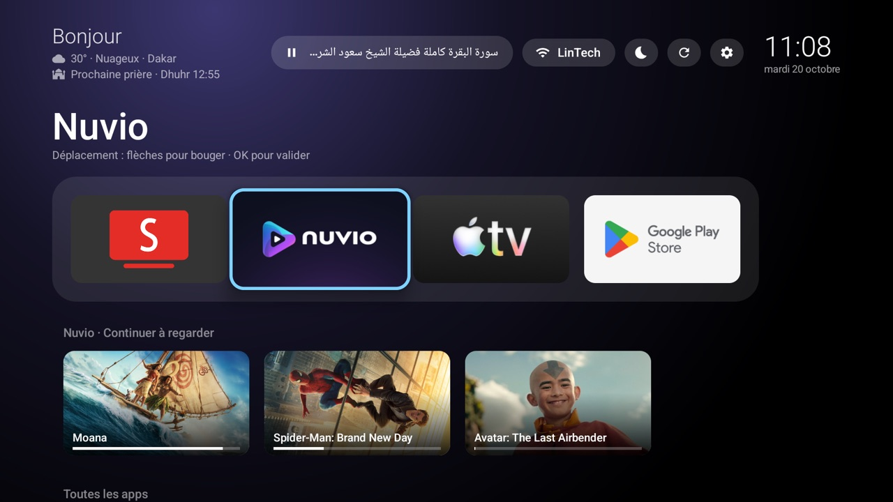 |

- **Déplacer**: move it with the arrows, OK to drop it. The first 4 apps make the dock.
- **Masquer**: hides it from the home screen.
- **Renommer**: gives it another name. "Nom d'origine" restores the original.
- **Infos de l'app**: Android's page for the app (storage, permissions, force stop).

Hidden apps go into **Apps masquées**, at the end of the grid. OK on it brings one back.

| Hidden apps tile | Bringing one back |
|---|---|
| 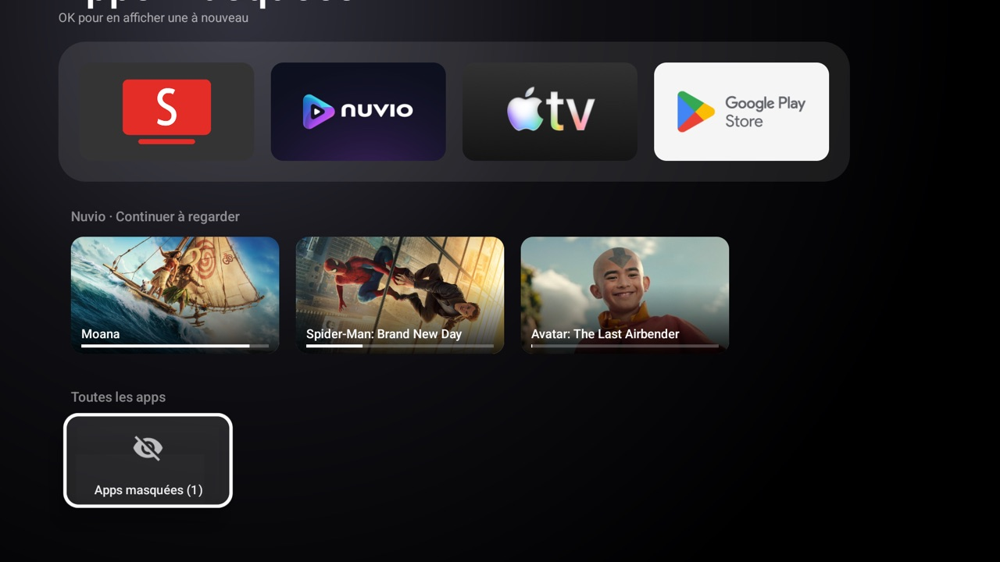 | 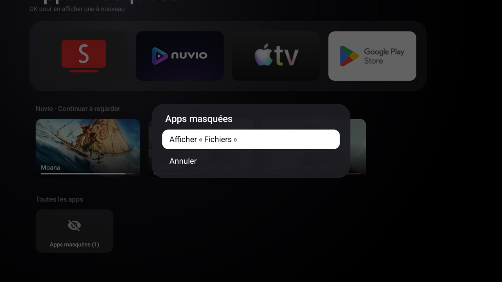 |

New apps appear at the end of the grid by themselves.

---

## Sleep, timer, restart

**🌙 Veille** puts the Pi to sleep now or later. While a timer runs, the button shows the time
left, and its menu adds "Annuler la minuterie". Any button on the remote wakes the Pi.

| Sleep menu | Timer running |
|---|---|
| 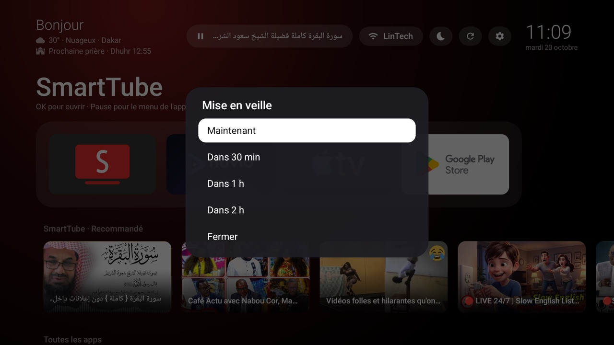 | 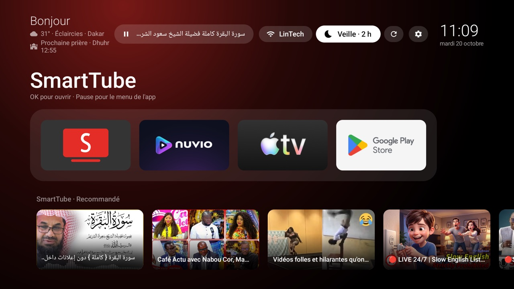 |

**⟳ Redémarrer** restarts the Pi, after a confirmation.

After midnight, if nothing has been touched for an hour, the Pi goes to sleep by itself.

---

## Paramètres and Infos Pi

| ⚙ menu | Infos Pi |
|---|---|
| 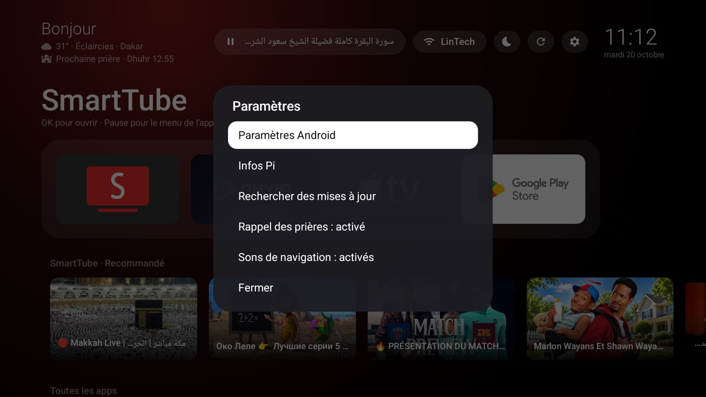 | 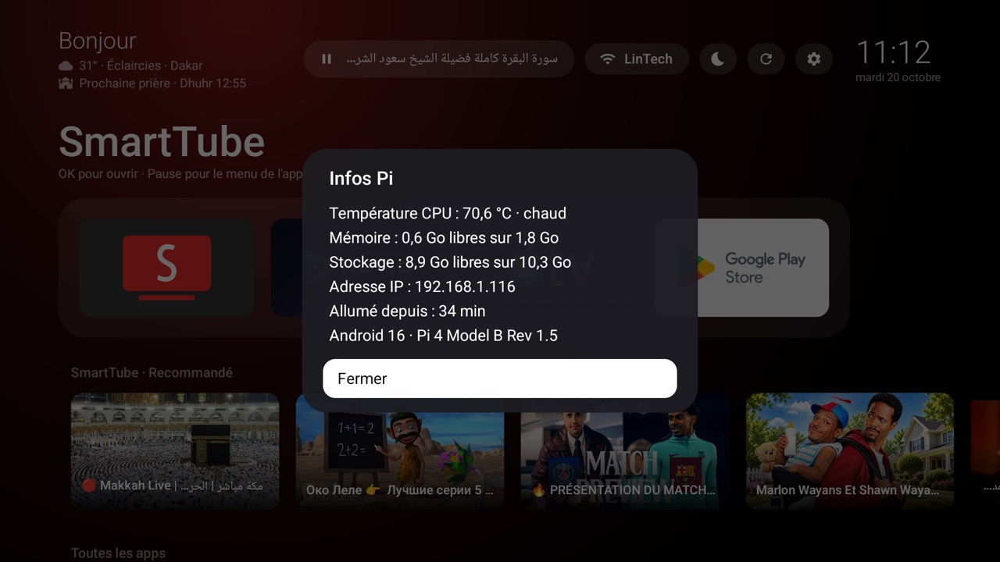 |

- **Paramètres Android**: the usual Android TV settings.
- **Infos Pi**: processor temperature, free memory and storage, IP address, time since the last
  restart. Refreshes every 2 seconds. Up to about 75 °C is normal; the Pi slows itself down from
  80 °C.
- **Rechercher des mises à jour**: checks SmartTube and Nuvio now (see below).
- **Rappel des prières**: turns the prayer reminder on or off.
- **Sons de navigation**: Android's click sounds.

---

## Prayer times

The next prayer shows under the weather. At prayer time, a banner appears for 30 seconds, even
over SmartTube or Nuvio.

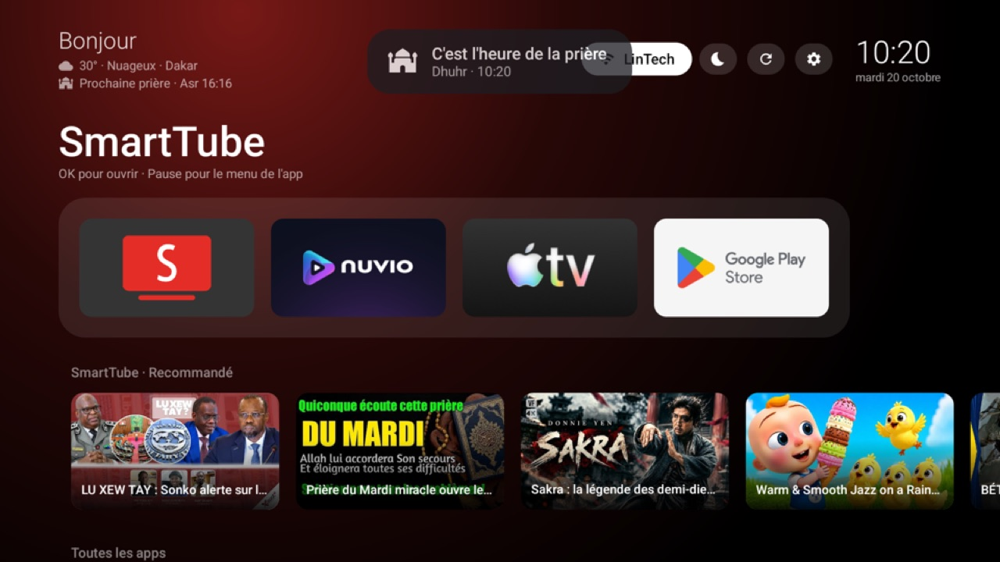

Times come from [Aladhan](https://aladhan.com) with the Muslim World League method, for the
location of your internet connection (Dakar). Mosques sometimes differ by a few minutes,
especially for Fajr and Isha.

---

## Screensaver

After 15 minutes without input, a thin clock appears over the last glow colour. It moves every
minute so nothing burns into the TV. Any button brings back the home screen.

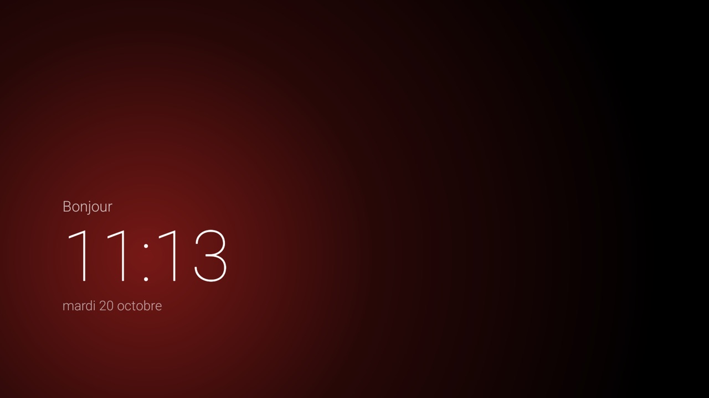

---

## App updates

SmartTube and Nuvio don't come from the Play Store, so nothing updates them. Pi Home checks
their GitHub releases 20 seconds after the Pi starts, then every 12 hours. When there's a new
version, a **⬆** button appears in the top bar: choose an app, or "Tout mettre à jour". It
downloads the Pi 4 version and installs it silently. Settings and logins are kept.

Installing an update closes the app, so it stops anything it was playing.

---

## The LG remote

| Button | On the Pi |
|---|---|
| ↑ ↓ ← → | Navigate; hold to scroll |
| **OK** | Select |
| **Play** ▶ | Play in apps; opens the highlighted app on the home screen |
| **Pause** ⏸ | Play/pause in apps; opens the app menu on the home screen |
| **Stop** ■ | Home |
| **Back** | Back |
| Skip ⏭ | Next |
| EXIT, colours, numbers | Nothing: the TV keeps these |

If the remote stops responding, switch the TV input away from HDMI 3 and back.

---

## Recommended SmartTube settings

- **Video quality** (in the player): **480p 30fps avc**. The Pi 4 decodes AVC (H.264) in
  hardware; VP9 and AV1 fall back to the processor, which runs hotter and can stutter. Take 60 fps
  only for sport or games.
- **Paramètres → Lecture en arrière-plan → Uniquement l'audio**: keeps the sound playing after
  Stop ■, and shows the now-playing button.

---

## Build and install

You need the Android SDK (build-tools 36.1.0, platform 36) and Android Studio's bundled JDK, as
installed by Android Studio on macOS. There is no Gradle.

```sh
./build.sh            # builds build/pihome.apk
./build.sh install    # builds and installs over the Pi's copy, keeping your settings
./setup.sh            # full install on a fresh Pi: system files, reboot, settings
```

`PI_HOST` changes the Pi's address (default `192.168.1.116:5555`).

Updating Pi Home restarts the home screen, which also stops SmartTube's background audio.

Back up **`pihome.keystore`**. It signs the app, and updates must use the same key. It's
deliberately left out of Git.

## Project layout

| Path | What it is |
|---|---|
| `src/com/sall/pihome/` | The launcher. `MainActivity` is the home screen; `WatchNext`, `Weather`, `Prayers`, `Updates`, `PiInfo` fetch its data; `ClockDream` is the screensaver; `GlowView` draws the glow |
| `res/` | Icons and the theme |
| `AndroidManifest.xml` | Permissions, the home screen and the screensaver |
| `bridge/lg-simplink.sh` | The LG remote bridge, which also carries out sleep, restart and installs |
| `bridge/lg-simplink.rc` | Starts the bridge at boot |
| `privapp-permissions-pihome.xml` | Allows the launcher's two system permissions |
| `build.sh`, `setup.sh` | Build, and install on a fresh Pi |
| `docs/` | This guide's screenshots and [HOW-IT-WORKS.md](docs/HOW-IT-WORKS.md) |
